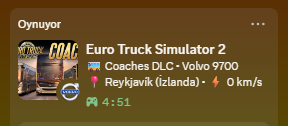

# 🚌 EuroPulse RPC — ETS2 & Coaches DLC Discord Rich Presence

[](LICENSE)
[](https://www.python.org/)
[](https://store.steampowered.com/app/3809270/Euro_Truck_Simulator_2__Coaches/)
[](#kurulum)

**EuroPulse RPC**, **Euro Truck Simulator 2** ve yeni **Coaches DLC (Otobüs DLC)** oynarken Discord'daki sade *"Euro Truck Simulator 2 oynuyor"* durumunu canlı telemetri verileriyle zenginleştiren, arka planda sessizce çalışan hafif bir Discord Rich Presence servisidir.

---

## ✨ Örnek Discord Görünümü



```text
Oynuyor: Euro Truck Simulator 2
  🚌 Volvo 9700 • Rotada 196 km
  📍 Eindhoven (Hollanda) • ⚡ 113 km/s
  ⏱️ 08:28 geçti

  [Büyük Görsel] Coaches DLC • Volvo 9700 (MA BG 275)
  [Küçük İkon]   🚌 Volvo 9700 (MA BG 275) • Vites: D12 • 1450 RPM
```

---

## 🚀 Özellikler

- **Coaches DLC & Otobüs Algılama:** Volvo 9700, Setra, Mercedes-Benz Travego/Tourismo, Neoplan, MAN Lion's Coach, Irizar vb. otobüs şasilerini ve `dlc_bus.scs` / süspansiyon sınıfını tanıyarak Coaches DLC kapağını ve otobüs durumunu otomatik gösterir.
- **Anlık Şehir & Ülke Tespiti (`617` Şehir):** Tüm ETS2 harita DLC'lerini kapsayan `cities_ets2.json` koordinat veritabanı sayesinde geçtiğiniz en yakın şehri ve Türkçe ülke adını anlık olarak hesaplar.
- **Canlı Telemetri Verileri:**
  - ⚡ Anlık hız (`km/s`)
  - 🧭 Navigasyonda kalan rota mesafesi (`km`) ve kalkış ➔ varış hattı
  - 🪪 Araç marka/model ve plaka (`MA BG 275` vb.)
  - ⚙️ Gösterge vitesi (`D1`, `R`, `N`) ve motor devri (`RPM`)
  - ⏸️ Mola / Ana Menü / Serbest Sürüş durum geçişleri
- **Sıfır Yük & Sessiz Başlangıç:** Windows açılışında penceresiz (`pythonw.exe` + `.vbs`) olarak bekler; ETS2 açık değilken yalnızca 5 saniyede bir hafif süreç kontrolü yapar ve oyun kapandığında Discord durumunu otomatik temizler.
- **Akıllı Fallback:** Oyun telemetri DLL'i henüz yüklenmemiş olsa bile `game.log.txt` üzerinden şehir ve DLC bilgisi okumaya devam eder.

---

## 📦 Dosya Yapısı

| Dosya | Açıklama |
| :--- | :--- |
| `ets2_rpc.py` | Canlı `Local\SCSTelemetry` okuyucu ve Discord IPC Rich Presence servisi |
| `cities_ets2.json` | 617 Avrupa şehrini ve Türkçe ülke adlarını içeren koordinat veritabanı |
| `plugins/scs-telemetry.dll` | RenCloud `scs-sdk-plugin` v1.12.1 (Win64) bellek paylaşım eklentisi |
| `kurulum.bat` | Bağımlılıkları kuran, DLL'i ETS2'ye kopyalayan ve başlangıca ekleyen kurulum betiği |
| `kaldir.bat` | Arka plan servisini durduran ve Windows başlangıç kaydını kaldıran betik |
| `baslat_rpc.bat` | Manuel arka plan başlatma kısayolu |
| `requirements.txt` | Gerekli Python paketleri (`pypresence`, `truck-telemetry`, `psutil`) |

---

## 🛠️ Kurulum

### Yöntem 1: Otomatik Kurulum (Önerilen)

1. [Releases](../../releases) sayfasından güncel `EuroPulse-RPC-v1.0.0-win64.zip` paketini indirin ve kalıcı bir klasöre çıkarın (ör. `C:\Program Files\EuroPulse-RPC` veya `Documents\EuroPulse-RPC`).
2. Sisteminizde [Python 3.10+](https://www.python.org/downloads/) kurulu olduğundan emin olun.
3. **`kurulum.bat`** dosyasına çift tıklayın.
   - Python paketlerini (`pypresence`, `truck-telemetry`, `psutil`) otomatik kurar.
   - ETS2 kurulum dizinini bulup `scs-telemetry.dll` dosyasını `bin\win_x64\plugins\` klasörüne kopyalar.
   - Windows Başlangıç klasörüne sessiz başlatma kaydı ekler ve servisi başlatır.
4. ETS2 o sırada açıksa bir kez yeniden başlatın (ETS2 açılışta `SDK` kullanım izni sorarsa **Tamam**'a basın).

### Yöntem 2: Manuel Kurulum

1. Depoyu klonlayın:
   ```powershell
   git clone https://github.com/TheDarkGuardian/EuroPulse-RPC.git
   cd EuroPulse-RPC
   ```
2. Python paketlerini kurun:
   ```powershell
   pip install -r requirements.txt
   ```
3. `plugins/scs-telemetry.dll` dosyasını ETS2 kurulumunuzdaki şu konuma kopyalayın:
   ```text
   <ETS2 Klasörü>\bin\win_x64\plugins\scs-telemetry.dll
   ```
4. Servisi penceresiz başlatın:
   ```powershell
   pythonw.exe ets2_rpc.py
   ```

---

## 🧹 Kaldırma

Arka plan servisini durdurmak ve Windows başlangıcından kaldırmak için **`kaldir.bat`** dosyasını çalıştırmanız yeterlidir.

---

## 🙏 Teşekkür ve Kaynaklar

- [RenCloud / scs-sdk-plugin](https://github.com/RenCloud/scs-sdk-plugin) — ETS2 paylaşımlı bellek telemetri eklentisi (`scs-telemetry.dll`)
- [pypresence](https://github.com/qwertyquerty/pypresence) & [truck-telemetry](https://pypi.org/project/truck-telemetry/)

---

## 📄 Lisans

Bu proje [MIT Lisansı](LICENSE) altında lisanslanmıştır.
